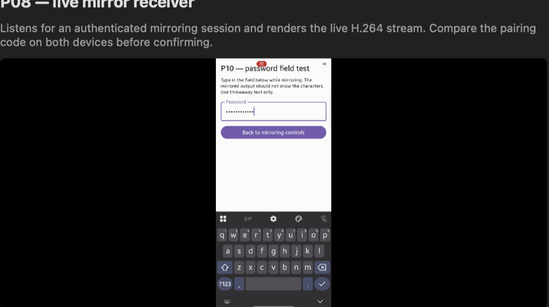

# P10 — Secure screen and screenshare-protection behaviour

**Status: in progress (2026-11-12).** Synthetic `FLAG_SECURE` and the Slice banking app are withheld from the mirror as required, and the password-field case now has captured mirrored pixels showing mask dots. Two cases are not closed: the notification shade does not mirror at all (the picture freezes and the receiver then closes the session on its control-frame guard — an open defect, section 3), which also blocks the two OTP-notification observations.

> This report records evidence only. No attempt is made to bypass `FLAG_SECURE`, DRM, banking-app protections or protected surfaces (prohibited by AGENTS.md / security policy).

| Field | Value |
|---|---|
| Prototype | P10 — secure screen/protection in end-to-end mirrored output |
| Depends on | P01/P08 (P01 complete; P08 live mirroring working, P08 acceptance not fully closed) |
| Android device | Samsung Galaxy S24 Ultra, **SM-S928B** (model reported in session; Android 17 / API 37, One UI 9.0 per prior project baseline) |
| Mac | MacBook Air (M1, 2020), macOS 27.0.1, Xcode 27.2; rebuilt Debug `DroidBridge.app` (`--p08-mirror`) with live PTS/timebase fix (`8937f3d`) |
| Mirroring experiment app | `com.droidbridge.experiment.mirroring` debug build including synthetic FLAG_SECURE toggle (`899cc87`) |
| Commits (relevant) | `92bb313` (Android mirroring start off main thread), `accae04`/`8937f3d` (Mac live mirror + PTS rebase), `899cc87` (P10 FLAG_SECURE toggle) |
| ADB/debug state at log capture (2026-11-12) | `adb devices -l` showed `192.168.31.106:5555 device ... transport_id:2` (Wi-Fi ADB) only — **USB connected: no** per adb listing at capture time; **USB debugging: not determined from this host**; **wireless debugging/ADB over Wi-Fi: yes** (device reachable at `192.168.31.106:5555`). Earlier same-day sessions included USB/USB-debugging; record the authoritative state per test run. The sections added later in the day (11:18–11:26) ran in the same state: **USB not connected**, wireless ADB on `192.168.31.106:5555`, no USB debugging possible without a cable. |

## Evidence

### 1) Synthetic `FLAG_SECURE` window (own experiment app) — observed correct

**Goal:** with mirroring active, toggling `WindowManager.LayoutParams.FLAG_SECURE` on the mirroring experiment window should cause the mirrored view to show black/blank/unavailable for that protected window, and clearing it should restore the live image. No protection bypass.

**Implementation (scoped to experiment):** `MirroringActivity` sets/clears `FLAG_SECURE` on its window via a UI toggle and logs `P10 FLAG_SECURE test: ON/OFF` (`899cc87`).

**Session/log evidence (S24, `adb -s 192.168.31.106:5555 logcat -d -s P08Mirroring`, 2026-11-12):**
- Fresh pairing after clearing stale Mac pin: forgot pin for `DroidBridge-P08-Mac` (09:51:32.721), discover/resolve `192.168.31.109:59490`, handshake `TLSv1.3` `authenticated=false` code `609218` (09:51:36.827), pairing confirmed and pin persisted (09:51:45.354), `peerPin=3b3d878a9b77bf4436d139b36a032a07ac3c5bdcd569fd77971e1384f7578fb7`.
- Mirroring started: consent requested/granted (09:51:53.003 / 09:51:56.156), service started (09:51:56.432), pipeline `590x1280` from content `1080x2340` encoder `c2.qti.avc.encoder`, `mirror.format` sent (09:51:56.517). Session remained active with `dropped=0`, `stopReason=active` (sampled frames 186→339, 09:52:01–09:52:26).
- **09:51:59.219** `P10 FLAG_SECURE test: ON (this window should appear black/blank in the mirror)`
- **09:52:01.307** `P10 FLAG_SECURE test: OFF`

**User-observed Mac result (2026-11-12):** when the toggle was turned **ON**, the Mac mirror showed a **black screen**; when turned **OFF**, the screen/image was visible again. This matches the expected protected-content behavior (FLAG_SECURE honoured in capture/mirror; no bypass).

**Result:** **Pass (synthetic FLAG_SECURE toggle, this run).** Protected window content was not shown in the mirror while secure; normal mirroring restored when cleared.

### 2) Banking app (Slice) — non-invasive observation, protected output observed

**Setup:** live mirroring active to Mac; user opened the Slice banking app on the S24 (non-invasive observation only — no interaction, no bypass attempt).

**User-observed Mac result (2026-11-12):** Mac mirror showed a **black screen** while Slice content was in the foreground.

**Result:** **Consistent with expected protected behavior** (protected/secure surface withheld from capture/mirror). Detailed session timing/log correlation for this specific observation was not captured in the log excerpt above; treat as a user-reported non-invasive observation pending a fully correlated evidence run if needed.

### 3) Notification shade while mirroring — **the stream freezes and the session dies**

**Setup:** live session (`590x1280` from `1080x2340` rendering correctly — the same session had just
shown the password case below), then the shade opened with a down-swipe from the status bar.

**Observed on the phone:** the quick-settings panel was open (`mCurrentFocus=Window{…
NotificationShade}`, `isKeyguardShowing=false`, `exec-out screencap` shows the QS panel).

**Observed in the mirrored video:** the Mac kept displaying the frame from *before* the shade opened.
Re-capturing the window region at 11:52, 11:53 and after collapsing the shade all returned the same
frozen frame with the phone's screen obviously changing, so this is not a lag artefact.

**Then the session was closed by the receiver:** the Mac's own guard ended it twice, with

```
CLOSED framing/protocol violation: peer exceeded 120 control frames per second
state=stopped received=2840 enqueued=2840 dropped=0
```

while the phone's last stats line stayed at `frames=1240 … keyframes=21 fps=10.3 dropped=0` and the
final teardown recorded `frames=1551 keyframes=26` (`receive stopped: SessionException: peer closed
the connection`). Frames kept being counted by the receiver while the picture never advanced, and the
control-frame budget (`maxFramesPerSecond = 120` in `SecureListener.enforceRateLimit`) blew out.

**Verdict: not a pass and not a P10 security result — an open P08/P10 defect.** Nothing protected was
leaked (the shield is the opposite problem: the new content never reaches the mirror), but the shade
cannot be observed in the mirror at all until this is fixed, so the "shade is ordinary system UI and
mirrors normally" statement this document made earlier is **withdrawn**: it was inferred from
`mCurrentFocus` plus a rising `frames=` counter, not from watching the picture. Watching the picture
shows a freeze.

Reproduction on 2026-11-12: session #1 froze at `frames=1240` and closed at 1550; session #2 (fresh
pairing, same app run) froze and closed the same way. Both closures name the control-frame limit.

**Lock, for contrast:** locking the device revokes the projection outright (`KEYCODE_SLEEP`,
`isKeyguardShowing=true` → `system onStop`, Mac `MIRROR_STOP`), so a lock screen leaves nothing to
mirror at all — recorded in full in the [P08 report](P08-live-mirroring.md#5-session-stops-when-mediaprojection-stops-u10).

### 4) Synthetic OTP notifications, with and without `setPublicVersion()` — posted, verdict pending

Both controls ran against the live session and are confirmed at the notification-service level with
`dumpsys notification --noredact`:

- **With public version** (`id=102`): the record carries
  `publicVersion=Notification(channel=p10-test … flags=0 …)`; the public version's content is
  `P10 notification` / `Synthetic notification (no code shown)`, while the private version holds
  `OTP-TEST-482913`.
- **Without public version** (`id=101`): the record has no `publicVersion` field at all.
- App log: `P10 synthetic OTP notification posted publicVersion=true` (11:23:49) and
  `… publicVersion=false` (11:23:59).

What the *mirror* displays for each is a visual observation, and it is **blocked by the shade defect
in section 3**: every attempt to look at a notification ended with the mirrored picture frozen on the
pre-shade frame and the session closed by the control-frame guard. A heads-up banner without opening
the shade was tried as well and ended the same way. The notification state itself is confirmed
(dumpsys), so only the last mile — what a viewer sees — is missing, and it cannot be seen until the
freeze is fixed.

### 5) Password field — **pass, with the mirrored pixels captured**

The password test screen is a real `EditText` with `password="true"` (`uiautomator` dump); the field
was focused and `PELICAN-7731` typed through the input system while the session was live
(`state=mirroring 590x1280 … dropped=0`). The mirrored frame was then captured from the Mac window:



The mirrored field shows eight mask dots, not `PELICAN-7731`, so password input is not readable in the
mirror. This is the captured counter-example to the earlier "verdict pending" note: it needed
`--p08-allow-capture` first, because `AVSampleBufferDisplayLayer.preventsCapture` is on by default and
made every `screencapture` of the video area black — the black frames were the capture being blocked,
not the stream being empty.

**Caveat that matters for honest reading:** this proves what the *decoder output* looks like, which is
what a viewer sees on this Mac. It does not prove anything about other capture sinks.

### 6) No protected frames cached in app storage

`run-as com.droidbridge.experiment.mirroring` after the runs: `files/` contains only
`profileInstalled` (24 bytes) and `cache/` is empty. No frame, screenshot or buffer file exists in
the app's sandbox, so nothing from the capture path is persisted by this app. (This covers the app's
own storage; it does not audit other processes or the system's own buffers.)

## Not yet tested (P10 remaining)

- **The shade freeze defect (section 3)** — root cause unknown. The receiver counts control frames
  from the phone at >120/s and closes the session, while the phone's picture stops advancing. Until it
  is fixed, the shade and every notification observation (including both OTP variants) is unobservable
  in the mirror.
- Additional banking/DRM apps by **non-invasive observation only** (no interaction, no bypass).
- Correlated evidence runs for each case with USB/USB-debugging/wireless-debugging state recorded per
  run (this session: USB not connected, wireless ADB on, `192.168.31.106:5555`).

## Running the cases

Mirroring must be live (Mac `P08 Mirror` listening, phone connected and capturing) before each case.
All four steps below were executed on 2026-11-12 (see sections 3–5); they stay here as the
reproduction procedure. **Capture the Mac window with `--p08-allow-capture`**, otherwise the video
area photographs as black (the layer sets `preventsCapture`). Steps 2–3 remain blocked by the freeze
in section 3:

1. **Password field** — tap *P10: Open password-field test screen*, focus the field, type throwaway
   text, watch the Mac. Back to the controls with *Back to mirroring controls*.
2. **OTP notification, no public version** — tap *P10: Post OTP notification (no public version)* and
   read the Mac (shade open and closed).
3. **OTP notification, with public version** — tap *P10: Post OTP notification (with public version)*
   and compare. The public version carries no code, so if the mirror shows a redacted form that is
   the expected result; if it shows the code that is a finding to record.
4. **Lock screen / shade** — lock the device and pull the shade down mid-session; record whether the
   stream stops (P01 showed lock fires `onStop()`), goes black, or shows unprotected content.

Record the Mac observation, `adb logcat -s P08Mirroring P08Encoder` around each step, and the
USB/debugging state for the run.

### Capturing the mirrored video as evidence

The Mac app sets `layer.preventsCapture = true`, so `screencapture` photographs the video area as solid
black even while frames decode — that is what made the first P10 attempts look like "the mirror shows
nothing". Start the app with `--p08-allow-capture` for evidence runs:

```
open -n macos/build/Build/Products/Debug/DroidBridge.app \
  --args --p08-mirror --p08-allow-capture
screencapture -x -R1076,140,590,330 out.png   # the window's video region
```

The flag only flips `preventsCapture`; nothing else in the render or capture path changes, and it is
off unless the argument is passed.

## Limitations

- Mac-side visual outcome for the synthetic toggle is user-confirmed; not independently screenshot-captured by this tooling.
- ADB state recorded here reflects the host view at capture time (Wi-Fi ADB reachable); per-run USB/debugging state must still be recorded explicitly for each acceptance-relevant test.
- Banking-app observation is non-invasive and user-reported; no protected content was inspected, extracted, or bypassed.

## Current assessment

**In progress, two cases blocked.** Protected surfaces are withheld as required in every case that has
actually been observed (synthetic `FLAG_SECURE`, the Slice banking app, the password field with captured
pixels), and the lock screen cannot leak because locking stops the capture. P10 stays open for two
reasons, neither of them a security answer: the shade freeze (a stream defect that must be fixed before
any notification can be observed at all) and the resulting inability to see the OTP notifications in
the mirror.
